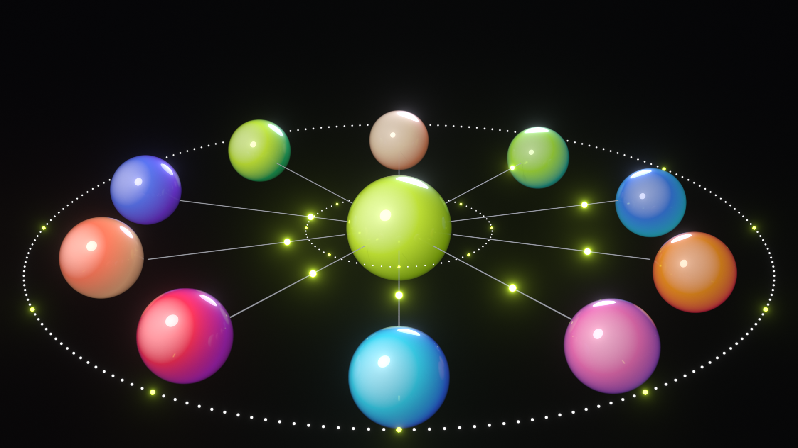
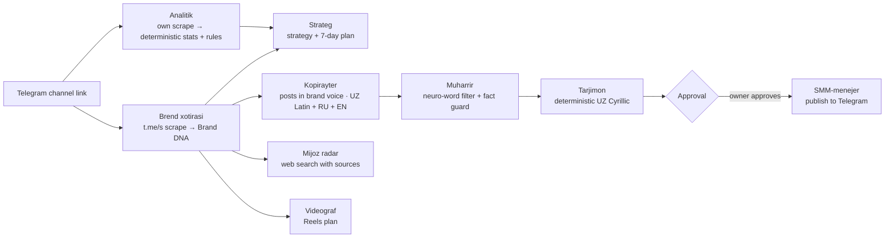

<div align="center">

# Mercat

**An AI marketing department for small businesses in Uzbekistan.**
Paste your Telegram channel link — ten AI employees learn your brand voice, audit your real numbers, plan the week and write posts in Uzbek (Latin and Cyrillic), Russian and English. You only approve.

*Bir havola — butun marketing bo‘limi.* · *Одна ссылка — весь отдел маркетинга.*

[](https://github.com/stuffdealerog-collab/mercat/actions/workflows/ci.yml)
[**Live app**](https://mercat-ai.vercel.app) · [**Studio demo**](https://mercat-ai.vercel.app/studio?demo=bir-havola&channel=t.me/safiabakery) · [**Telegram bot**](https://t.me/hackathonproj1_bot) · [Concept board](https://mercat-ai.vercel.app/concept)



</div>

---

## Why

In a small Tashkent business, marketing is one tired person — usually the owner. They write the posts, translate them into Russian, chase a designer, shoot Reels and still don't know where their customers are. Generic chatbots start from zero every time, write the same clichés for everyone and invent facts.

We heard this directly from people at the MARS AI Hackathon (Techstars Startup Week Tashkent, November 2026): a marketing director who wants *"one service that learns how I think, so I can delegate the routine"*, an SMM specialist who can't find *"an app that makes a product video without AI slop"*, and founders who say the hardest part is *finding clients*.

## The AI department

| Employee | Role | What it does |
|---|---|---|
| **Brend xotirasi** | Brand memory | Reads your public channel and your notes, builds a Brand DNA: tone, *siz*/*sen*, emoji density, post length, CTA style, products, do's and don'ts |
| **Analitik** | Analyst | Audits real channel numbers — views, reach, posting rhythm, formats, competitors — with deterministic statistics |
| **Strateg** | Strategist | Positioning, audiences, offer, content pillars and a 7-day plan where every post has a goal, hook, single CTA and metric |
| **Kopirayter** | Copywriter | Writes posts in *your* voice, using your own posts as examples and only facts you provided |
| **Muharrir** | Editor | Removes "neuro-words" (AI clichés) and rejects any rewrite that invents numbers, dates, prices or promos |
| **Tarjimon** | Translator | Uzbek Latin, Uzbek Cyrillic (deterministic transliteration, not an LLM), Russian, English |
| **Dizayner** | Designer | Ad stills from a product photo through the media API when an image provider key is configured (the Studio shows cover placeholders for now) |
| **Videograf** | Videographer | Reels/TikTok scripts; product photo → ad video jobs through the media API when a video provider key is configured (not yet wired into the Studio) |
| **SMM-menejer** | Publisher | Publishes to the owner's Telegram channel after approval |
| **Mijoz radar** | Client radar | Finds where your customers are — channels, groups, bloggers, events — with sources |

**Killer feature — "Bir havola".** Paste one channel link and the whole department runs on a live node canvas in about a minute: Brand DNA, an audit, a strategy, posts in four scripts, places where your customers are and a Reels plan.

## Not another AI wrapper

- **Code decides what is true.** Channel statistics, thresholds and decision rules are computed deterministically. The model only phrases findings: every audit finding and plan hook must cite an evidence id from a ledger, otherwise it is dropped and replaced by a rule template.
- **No invented facts.** The editor's output is checked by code: new numbers, dates, weekdays, prices, promo or urgency words that were not in the input make the rewrite fail, and a deletion-only edit is used instead.
- **Uzbek done properly.** Cyrillic is produced by rules with tests (o‘/g‘ apostrophe variants, *e*→*э*, *ye/yo/yu/ya*, loanwords, brand names kept), plus Uzbek suffix assimilation (*keshbekka*, not *keshbekga*).
- **Honest by default.** Not enough data → the app says so. Any sample data in the UI is visibly labelled *namuna*.
- **Human in the loop.** Nothing is published until the owner taps Publish. Promotions, prices, videos and a new brand's first posts are flagged as sensitive and wait for approval by default; autopilot for routine posts is a beta setting.

## How it works



## Tech stack

| Layer | Choice |
|---|---|
| App | Next.js 16 (App Router), React 19, TypeScript, Tailwind CSS 4 |
| Studio UI | @xyflow/react (node canvas), motion, lucide-react, zustand |
| AI | Anthropic Claude API (`claude-sonnet-5-5`, `claude-haiku-5-5`) with structured outputs and server-side web search |
| Data | Neon Postgres (serverless HTTP driver, parameterized tagged-template SQL) |
| Telegram | grammY bot (webhook), Telegram Mini App with `initData` validation |
| Media | Provider interface for Higgsfield and fal.ai video generation (optional) |
| Hosting | Vercel (Frankfurt region) |
| Quality | Vitest, ESLint, TypeScript strict, GitHub Actions CI |

## Project structure

```
src/
  app/                    pages: landing, /studio, /concept, /stats, /qr, /tg (Mini App)
    api/
      telegram/           bot webhook (secret-token protected)
      auth/telegram/      Mini App initData login
      health/             liveness + DB round trip
      uslub/              the department API (brand, posts, neuro, analyze, strategy, ...)
  components/             studio canvas, panels, landing and concept board
  lib/
    uslub/                engine: scrape, Brand DNA, copywriter, editor, translit, radar, publish
      brain/              analysis + strategy: stats, rules + evidence ledger, audit, slot planner, lint + critic, calendar
      media/              video/image job pipeline and providers
    bot.ts, db.ts, ai.ts, telegram-auth.ts, track.ts
db/schema.sql             idempotent Postgres schema
scripts/                  db-migrate, set-webhook, vercel-env-push
tests/                    unit tests (translit, neuro guard, access control, brain stats, ...)
docs/                     brain spec, quality samples, creative playbook, video plans, marketing notes
```

> Internal module and route names still use the working name `uslub`; they will be renamed to `mercat` in one refactor.

## API

Routes take JSON bodies, return `{ error }` on failure and are rate limited. Methods are `POST` unless noted.

| Route | Purpose |
|---|---|
| `/api/uslub/brand` | Build or load a brand from a channel and/or owner knowledge (`GET ?id=` reads one) |
| `/api/uslub/analyze` | Channel audit with evidence-cited findings and competitor benchmark |
| `/api/uslub/strategy` | Strategy and 7-day content plan, critic-checked |
| `/api/uslub/posts` | Posts in four scripts with neuro-word report and sensitivity flags |
| `/api/uslub/neuro` | Remove AI clichés from a text (before/after human score) |
| `/api/uslub/radar` | Places where the customers are, with sources |
| `/api/uslub/video` | Reels plan: hook, scenes, voice-over, captions |
| `/api/uslub/plan` | Turn a task into a node graph of employees |
| `/api/uslub/department` | "Bir havola": brand, then posts, radar and video in parallel |
| `/api/uslub/publish` | Publish to the owner's channel (Telegram auth, ownership and admin-rights checks) |
| `/api/uslub/media`, `/media/jobs`, `/media/jobs/cancel`, `/media/captions` | Media jobs: `GET` provider status, `POST` create, `GET ?id=` poll, `POST` cancel, `POST` captions (needs a provider key or `MEDIA_DEMO=1`) |

## Getting started

Requirements: Node.js ≥ 20.12, pnpm 9.

```bash
pnpm install
cp .env.example .env.local      # then fill in the values (never commit this file)
pnpm db:migrate                 # creates tables in your Postgres
pnpm dev                        # http://localhost:3000
```

To connect the Telegram bot after deploying: set `TELEGRAM_BOT_TOKEN`, `BOT_USERNAME`, `TELEGRAM_WEBHOOK_SECRET` and `PUBLIC_URL`, then run `pnpm set-webhook`.

### Environment variables

| Variable | Required | Purpose |
|---|---|---|
| `DATABASE_URL`, `DATABASE_URL_UNPOOLED` | yes | Neon Postgres connection (pooled / direct for migrations) |
| `ANTHROPIC_API_KEY` | for AI features | Claude API (without it the bot answers with a fallback message and the department API fails) |
| `ANTHROPIC_MODEL` | no | Override the bot's chat model (the department API uses fixed models) |
| `TELEGRAM_BOT_TOKEN`, `BOT_USERNAME` | for the bot | Bot credentials and username (without `@`) |
| `TELEGRAM_WEBHOOK_SECRET` | for the bot | Verifies `X-Telegram-Bot-Api-Secret-Token` on the webhook |
| `PUBLIC_URL` | for the bot | Production origin, e.g. `https://mercat-ai.vercel.app` |
| `MENU_BUTTON_TEXT` | no | Label of the bot's Mini App menu button |
| `HIGGSFIELD_API_KEY` or `HF_API_KEY` + `HF_API_SECRET` | no | Higgsfield video/image generation |
| `FAL_KEY` | no | fal.ai video/image generation |
| `HIGGSFIELD_VIDEO_MODEL`, `HIGGSFIELD_IMAGE_MODEL`, `FAL_VIDEO_MODEL`, `FAL_IMAGE_MODEL` | no | Model path overrides for the media providers |
| `MEDIA_PROVIDERS`, `MEDIA_DAILY_LIMIT`, `MEDIA_USER_DAILY_LIMIT`, `MEDIA_ANON_DAILY_LIMIT`, `MEDIA_DEMO` | no | Media provider order, spend limits and offline demo mode |

## Quality and security

```bash
pnpm lint          # ESLint
pnpm typecheck     # route types + tsc --noEmit
pnpm exec vitest run
```

- Telegram Mini App `initData` is validated with HMAC (and `auth_date` age) on the server; the webhook requires a secret token.
- Publishing requires a verified Telegram user who owns the brand, targets the brand's own channel and is the channel's creator or an administrator with post rights; the bot's rights are checked too.
- Brand caches are only reused for data scraped from public channels, never for owner-supplied knowledge; owner ids are never returned to clients.
- LLM-heavy endpoints and bot onboarding are rate limited; media generation has daily caps.
- No secrets in the repository: `.env*` files are gitignored and excluded from deployments.
- Generated Uzbek copy from real channels, prepared for native-speaker review, lives in [`docs/quality/`](docs/quality).

## Status and roadmap

Working today: channel → Brand DNA, audit, strategy and plan, posts in four scripts, neuro-word editor, client radar, Reels plans, Telegram bot onboarding and authorized publishing, live usage stats at [`/stats`](https://mercat-ai.vercel.app/stats).

Next: a learning loop from published posts' views and link clicks, scheduled autopilot publishing, Instagram and YouTube publishing, rendered videos via the media pipeline, team seats, renaming internal `uslub` modules to `mercat`.

## Documentation

See [`docs/`](docs) — brain spec and samples, quality reviews, creative playbook, video storyboard and runbooks, marketing notes.

---

<div align="center">

Built during the **MARS AI Hackathon · Techstars Startup Week Tashkent 2026** with Claude Code.

Copyright © 2026 Mercat. All rights reserved. See [LICENSE](LICENSE).

</div>
