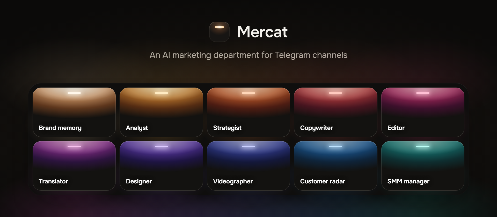
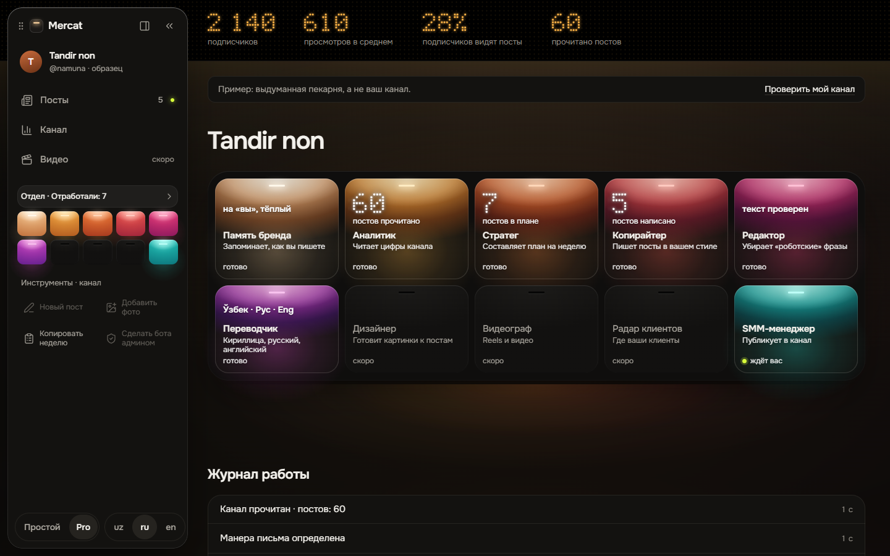
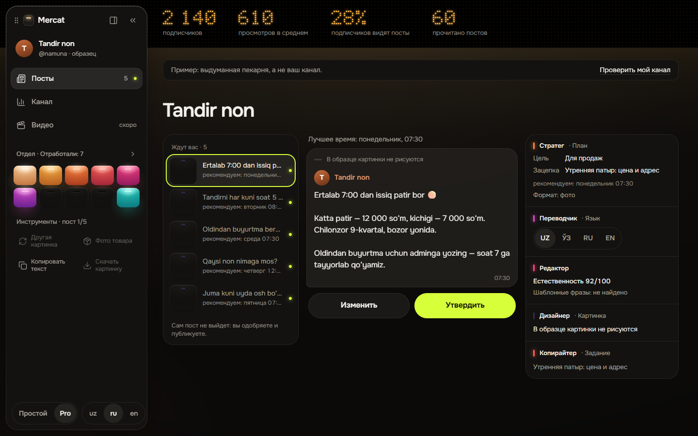
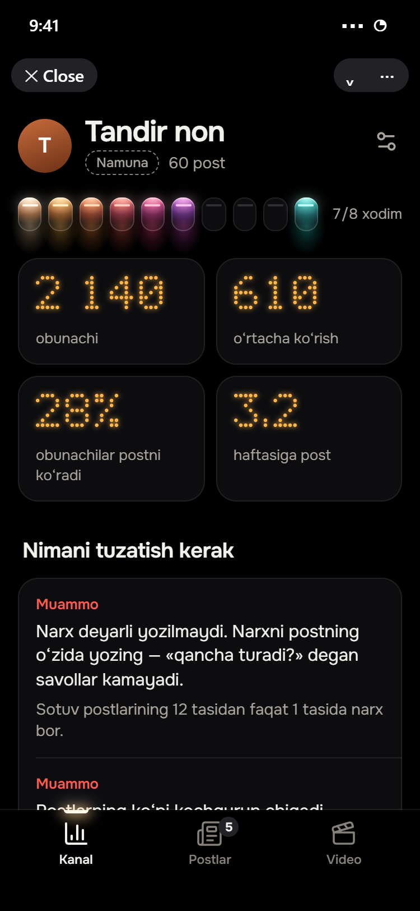
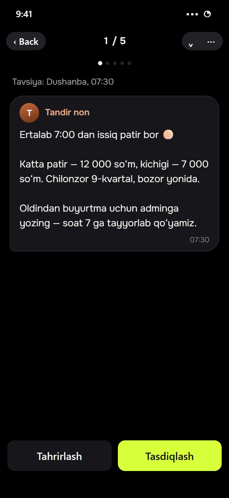

<div align="center">



**Paste a Telegram channel link, and Mercat reads the channel, plans the week and writes posts with pictures in your voice, ready for you to approve.**

*Telegram kanalingiz havolasini qo‘ying: Mercat bir haftalik postlarni rasmlari bilan tayyorlaydi, siz faqat tasdiqlaysiz.*<br>
*Вставьте ссылку на Telegram-канал: Mercat подготовит посты на неделю с картинками, а вы только утверждаете.*

[**Open Mercat**](https://mercat-ai.vercel.app) · [**Telegram bot**](https://t.me/hackathonproj1_bot) · [Sample bakery, no sign-up](https://mercat-ai.vercel.app/studio?mock=1)

[](https://github.com/stuffdealerog-collab/mercat/actions/workflows/ci.yml)

</div>

---

In a small Tashkent business the marketing department is usually the owner, at night, after closing. Mercat gives them one: ten employees drawn as lamps behind glass. A lamp glows while its employee works and stays lit when the result is ready. Nothing glows for decoration.

<p align="center">
  
  
</p>
<p align="center">
  
  &nbsp;
  
</p>
<p align="center"><sub>Screenshots use the built-in sample, a made-up bakery marked "namuna". No client data.</sub></p>

## How it works

1. **Paste a link** to a public channel. If the channel is still empty, describe the business and attach up to five photos instead.
2. **The department reads it.** The analyst counts subscribers, average views and how many subscribers actually see a post. The strategist turns that into a plan for the week.
3. **Posts arrive in your voice.** The copywriter learns from your own posts, the editor strips phrases that sound like a robot, and the designer draws each picture in the style of your channel's photos.
4. **You approve.** Edit a post or tap Approve. The bot publishes approved posts to your channel. Nothing goes out without your tap.

## What is in it

- **Simple and Pro.** On a phone, three steps and a strip of ten lights. On a computer the Studio opens in Pro: the full panel, a post queue, a preview and an inspector.
- **Telegram Mini App.** The same Studio inside Telegram at `/tg`. It follows Telegram's light or dark theme and uses Telegram's own buttons.
- **Pictures in the channel's style.** Claude reads the channel's recent photos and the owner's, writes the style down, and every post gets a picture rendered from that style with the channel's photos as references. Needs a fal.ai or Higgsfield key.
- **Uzbek, Russian, English.** The interface speaks uz, ru and en. Posts come in Uzbek Latin, Uzbek Cyrillic, Russian and English. Cyrillic is made by tested rules, not by a model.
- **Honest data.** Code computes the numbers and the model only words them. The editor rejects a rewrite that adds a price, a date or a figure that was not there. Anything that is not the owner's own data carries a dashed "namuna" label.

Video is not ready. Its tab says so instead of pretending.

## Stack

Next.js 16 (App Router), React 19, TypeScript, Tailwind CSS 4, zustand, motion · Anthropic Claude API (structured output, vision) · Neon Postgres · grammY bot and a Telegram Mini App · fal.ai or Higgsfield for pictures · Vercel, Frankfurt · Vitest, ESLint, GitHub Actions.

## Architecture

```text
src/app/                 landing /, Studio /studio, Mini App /tg, /stats, /qr; API routes under /api
src/lib/uslub/           the department: t.me/s scrape, brand voice, stats and rules (brain/), week plan, copywriter, editor, Cyrillic
src/lib/uslub/visual/    channel photos -> picture style; media/ renders one picture per post and keeps it on the post
src/lib/ai.ts            Claude calls with structured output: code decides what is true, the model phrases it
src/lib/bot.ts           grammY bot on /api/telegram: onboarding, previews, publishing after the owner approves
db/schema.sql            Neon Postgres via src/lib/db.ts (tagged-template SQL only): brands, posts, plans, media jobs
```

Internal paths still say `uslub`, the project's working name.

## Run it locally

Node.js 20.12 or newer and pnpm 9.

```bash
pnpm install
cp .env.example .env.local    # fill it in; it is gitignored, never commit it
pnpm db:migrate               # creates the tables
pnpm dev                      # http://localhost:3000, sample mode at /studio?mock=1
```

`.env.example` explains every variable. The app needs `DATABASE_URL`, `DATABASE_URL_UNPOOLED` and `ANTHROPIC_API_KEY`. The bot also needs `TELEGRAM_BOT_TOKEN`, `BOT_USERNAME`, `TELEGRAM_WEBHOOK_SECRET` and `PUBLIC_URL`, then `pnpm set-webhook`. Pictures need `FAL_KEY` or `HIGGSFIELD_API_KEY`.

Before a push:

```bash
pnpm lint
pnpm typecheck
pnpm exec vitest run
```

## Docs

- [Sprint plan for the 25.11 client demo](docs/sprint/2026-11-25-plan.md), [product spec](docs/sprint/product-spec.md), [desktop atmosphere](docs/sprint/desktop-atmosphere.md), [demo runbook](docs/sprint/demo-runbook.md)
- [DESIGN.md](DESIGN.md) for the lamp world, [PRODUCT.md](PRODUCT.md) for who it is for
- [Brand kit](docs/brand/brand-kit.md): the mark, logo, icons, link previews and covers in [`public/brand`](public/brand)
- [`docs/brain`](docs/brain) for the analysis engine, [`docs/quality`](docs/quality) for Uzbek copy reviews

---

<div align="center">

Built at the **MARS AI Hackathon**, Techstars Startup Week Tashkent 2026, with Claude Code.

Copyright © 2026 Mercat. All rights reserved. The code is public for viewing and evaluation only, see [LICENSE](LICENSE).

</div>
