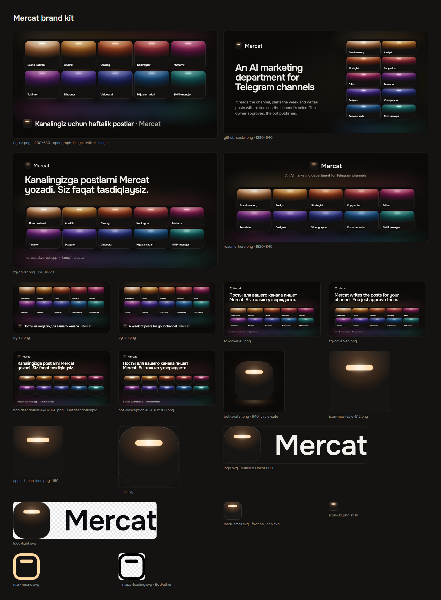

# Mercat brand kit

The mark is one lamp of the department: a dark glass tile with a warm filament (`#FFD6A0`, the Brend xotirasi hue) that throws a little light into the glass. It is the same object as the 22 px logo in the header (`src/components/lamp/Mark.tsx`), drawn as a vector. The rest of the identity lives in [DESIGN.md](../../DESIGN.md): the warm night stage `#0b0a09`, ten lamp hues in pipeline order, amber LED for measured numbers, lime only for the owner's action, Onest.



## Files

All in [`public/brand/`](../../public/brand), served at `https://mercat-ai.vercel.app/brand/<file>`.

| File | Size | Use |
|---|---|---|
| `mark.svg` | vector | The mark. Works from 24 px up to any size. |
| `mark-small.svg` | vector | Bolder filament on a 16/32 px grid. Favicons and anything under 24 px. Also `src/app/icon.svg`. |
| `mark-mono.svg`, `mark-mono-dark.svg` | vector | One colour (`currentColor`; filament white by default, near-black in `-dark`). Embossing, single-colour print, tiny UI. |
| `mark-full.svg` | vector | Full-bleed square for platforms that cut their own shape (iOS, Android maskable). |
| `logo.svg`, `logo-light.svg` | vector | Mark + "Mercat" in Onest 600, outlined, so it renders without the font. `logo.svg` for dark backgrounds, `logo-light.svg` for light ones. |
| `icon-16/32/48.png` | px | Favicon frames, also packed into `src/app/favicon.ico`. |
| `icon-192.png`, `icon-512.png`, `icon-maskable-512.png` | px | Web app manifest (`src/app/manifest.ts`). Maskable content stays inside the 40% safe circle. |
| `apple-touch-icon.png` | 180 | Same as `src/app/apple-icon.png`. Opaque, full-bleed. |
| `og-uz.png`, `og-ru.png`, `og-en.png` | 1200×630 | Link previews. The Uzbek card is `src/app/opengraph-image.png` and `twitter-image.png`. |
| `github-social.png` | 1280×640 | GitHub Settings → Social preview. |
| `tg-cover.png`, `tg-cover-ru.png`, `tg-cover-en.png` | 1280×720 | Channel post announcing the product. |
| `bot-avatar.png` | 640×640 | BotFather `/setuserpic`. Safe for the circular crop. |
| `bot-description-640x360.png`, `bot-description-ru-640x360.png` | 640×360 | BotFather `/setdescriptionpic`: the picture in an empty chat with the bot. Drawn at this size, lamps without names. |
| `miniapp-loading.svg` | vector | BotFather Mini App loading icon: one path of M/L/C/Z, one colour. Colours: light `#F2F2F6`, dark `#000000` (the Mini App's own stage). |
| `readme-hero.png` | 1920×840 | README header. |

What the owner still has to click (BotFather, GitHub): [owner-steps.md](owner-steps.md).

## Rules

- Keep the mark dark. The filament is the only light in it; never put the mark on a lamp hue or on lime.
- Clear space around the mark: a quarter of its width. Minimum size 16 px with `mark-small.svg`.
- In the lockup the gap and the type size are the UI's: 22 px mark, 8 px gap, 17 px Onest 600 at -0.015em. Scale the SVG; do not re-set the word.
- Covers and previews light all ten lamps at once. That is the lamp test from the first run (Spektr), the only moment the whole panel is lit without work behind it. Everywhere else the light means work.
- No invented numbers on brand images. The LED prints measured numbers only, so the covers carry none.

## Re-rendering

Everything is drawn by headless Chromium from [`build/kit.html`](build/kit.html) and the SVGs; no image APIs.

```bash
PLAYWRIGHT_CORE=<path to playwright-core> ONEST_DIR=<folder with onest-*.woff2> node docs/brand/build/render.mjs
```

`ONEST_DIR` needs `onest-latin.woff2`, `onest-latin-ext.woff2`, `onest-cyrillic.woff2` and `onest-cyrillic-ext.woff2`: the variable Onest faces that `next dev` downloads into `.next/dev/static/media` (Onest is under the SIL Open Font License). The wordmark in `logo.svg` was outlined from Onest 600 with fontTools, at the glyph positions Chromium shapes for "Mercat" (kerning r→c −10 units, tracking −15).
